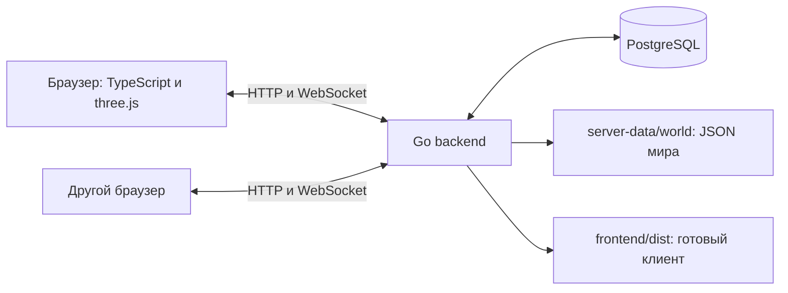

# Архитектура приложения

Описание текущего кода после реорганизации. Цели продукта — в
[требованиях](requirements.md), сетевые поля — в [API-контракте](api-contracts.md).

## Компоненты

Backend, БД и данные находятся на одном серверном ноутбуке. На остальных нужен
только браузер. Серверный браузер использует localhost; другие — LAN IP сервера.
HTTP-пути относительные, WebSocket использует текущий `location.host`.

## Границы модулей

| Часть | Ответственность |
|---|---|
| `frontend/src/app/` | Связывает интерфейс, графику, сеть и загрузчик |
| `frontend/src/auth/`, `ui/` | Форма входа, HTML/CSS, чат, HUD, миникарта и карточки |
| `frontend/src/game/` | Графика, управление, сущности, участки и взаимодействия |
| `frontend/src/network/` | Единственный HTTP/WS-адаптер и согласование загрузки |
| `backend/internal/auth/` | Регистрация, вход, выход, профиль, пароли и сессии |
| `backend/internal/realtime/` | Общий игровой цикл, WebSocket, чат и сетевые обработчики |
| `backend/internal/player/`, `world/` | Физика и столкновения; карта и выбор участков |
| `backend/internal/storage/`, `progress/` | SQL-инициализация, позиции; чтение учебного прогресса |
| `backend/internal/lobby/`, `httpx/` | Модель общей сессии; формат HTTP-ответов |

Игровые JSON хранятся в `server-data/world/`; файлы ИИ ещё не переданы.
Начальная схема `backend/migrations/001_initial.sql` встроена в бинарник и создаёт
отсутствующие таблицы. Версионированного механизма миграций пока нет.

## Поток данных

1. Вход по HTTP создаёт серверную сессию в cookie. WS открывается после проверки
   сессии; backend также проверяет её перед установлением соединения.
2. Сервер назначает машину и сообщает доступные по позиции участки. Клиент
   получает их по HTTP и подтверждает загрузку; затем разрешается управление.
3. Клиент отправляет команды WASD. Сервер считает физику с частотой 20 Гц и
   рассылает состояния примерно 10 раз в секунду. Браузеры отображают результат.
4. Позиция и направление сохраняются в PostgreSQL каждые пять секунд и при
   отключении. Аккаунты и сессии также хранятся в БД.
5. При смене области клиент выгружает дальние участки и освобождает геометрию,
   материалы и текстуры. Бюджет учитывает JSON, метаданные и резерв загрузок;
   рабочая цель — 8%. Это не GPU-память и не полный учёт генерируемых ресурсов.

## Текущая сцена и ограничения

Активен один перекрёсток: центр `(32,32)`, главная соединяет юг и запад.
Стартовые точки `(34.5,50)` и `(29.5,14)`, третья — парковка. Автобус неподвижен.
Из машины не выходим; камера фиксирована в салоне. Preview — отдельная локальная
сцена, не связанная с серверной картой.

Работают авторизация, общий мир, движение, чат, сохранение позиций и подгрузка.
Целевой помощник — один персональный NPC у каждого водителя: объясняет ошибки манёвров и учитывает его историю. Число моделей этим решением не фиксируется.
Карточки и окно знака подготовлены на клиенте. Проверка учебных действий,
LLM/RAG и память агентов ещё не подключены. Пустые каталоги `scenario/`, `ai/`,
`ai-service/`, `server-data/education/` и `models/` не означают готовые функции.

Учебные сценарии и персонажи сохранены в [отдельном документе](scenarios.md).
Распределение: Аня — Go/БД и серверная игровая логика; Даша К — локальный ИИ;
Даша П — интерфейс авторизации; Даша Ш — 3D-клиент, управление, сеть,
загрузка мира и интеграция.
